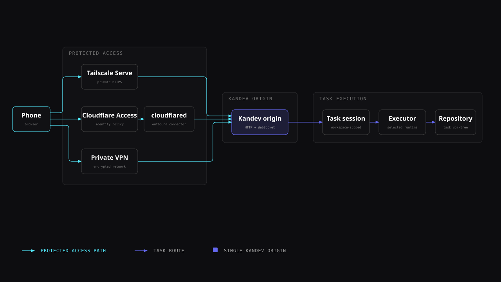

# Use Kandev from a Phone

This how-to guide connects a phone to Kandev through Tailscale, Cloudflare Tunnel, or a private VPN.

Anyone who can reach an unauthenticated Kandev origin has administrator access. Use a protected network boundary.

## Use task controls on a phone

The controls above the message composer keep task actions within reach. When
the task's pull requests are all merged or all closed without merging, a
full-width notice appears above the controls. Choose **Archive** to archive
the task using your confirmation preference, or dismiss the notice with **X**.
Dismissal hides the notice without archiving the task.

Todo, usage, sharing, and conversation controls remain available below the
notice. Extra controls wrap onto another line on narrow screens. The action
labelled with the next workflow step still moves the task to that step. In task
Chat, that action occupies a right-aligned row above the transcript utility
icons. Status icons and transcript utilities share the row below it when they
fit. They wrap onto additional rows when needed, with the message composer below.

## Confirm an action on a phone

Archiving from the **Tasks** sheet shows a dedicated confirmation step in that
same sheet. Review the task name, cleanup effects, and optional subtask selection.
The sheet shrinks to fit a short decision, with **Archive** and **Cancel** just
below the details and above the phone's safe area. Longer details scroll without
moving those buttons off screen.

Choose **Cancel** or **Back** to restore the list or editor's original height,
draft values, filters, and scroll position. Swiping the sheet away or tapping its
backdrop cancels the decision and closes the sheet. From the board or a page,
archive opens a compact bottom sheet.
Inside the command panel, confirmation stays in the panel and Cancel keeps your
search query. The archive-confirmation preference and cleanup behavior are unchanged.

The same pattern applies to other inline confirmations:

- Session deletion and terminal closing stay inside their open picker. Saved
  sidebar, Threads, GitHub, and GitLab views stay inside their filter/editor sheet.
  These sheets fit the confirmation's content instead of keeping the taller
  picker or editor height. GitHub's **Views** picker and GitLab's phone filters
  also open from the bottom.
- File deletion, chat context reset, plan revision restore, subtask detachment,
  and walkthrough discard use a compact sheet from the page. Resetting context
  inside Quick Chat stays in that dialog.
- Deleting saved prompts, layouts, agent profiles, or views from a menu opens a
  compact sheet. The menu closes first, leaving only one active decision.
- Removing integrations, watches, secrets, or plugins, and changing a user's
  role or status uses the same named confirmation. Secret values are never
  included in the confirmation.
- Removing workflow sync is a step in its existing configuration dialog. Cancel
  returns to the draft; a failed removal keeps the confirmation available to retry.

Full task-delete and discard-consent dialogs retain their existing layout and
safeguards, as do in-use conflict and system maintenance dialogs.
File deletion also uses a compact sheet on touch tablets.
Other desktop and tablet confirmation layouts are unchanged.

## How a phone request reaches an agent

Each protected path reaches the same Kandev origin. Kandev then sends task work to the selected executor.



[Open full-size SVG diagram][mobile-remote-access-diagram]

[mobile-remote-access-diagram]: ../../docs/screenshots/mobile-remote-access.svg

The diagram shows the important boundary: Tailscale Serve, Cloudflare Access with
`cloudflared`, and a private VPN are alternative protected paths to the same
Kandev origin. Kandev then owns the task session and routes work to the selected
executor and repository.

The access path protects the Kandev origin. Each path reaches the same Kandev web app and task features.
Kandev authentication remains a separate user and workspace boundary.

## Choose an access boundary

Use one of these boundaries:

| Use case | Network boundary | Kandev authentication |
| --- | --- | --- |
| One person, trusted phone and host | Private tailnet with a narrow Tailscale grant | Optional |
| One person, another private VPN | Private VPN address plus host firewall | Optional |
| One person, Cloudflare Tunnel | Cloudflare Access policy for one trusted identity | Optional |
| Multiple people or less-trusted devices | Private network or authenticated TLS proxy | Required |
| Public internet | Do not expose Kandev directly | Required behind a protected TLS proxy |

When authentication is disabled, Kandev gives every reachable client one synthetic administrator identity.

Enable [Authentication and Users](authentication.md) for accounts, private workspaces, sessions, or personal access tokens.

## Connect with Tailscale

This path keeps Kandev on loopback. Tailscale Serve provides the tailnet listener and HTTPS endpoint.

1. [Install Tailscale](https://tailscale.com/docs/install) on the Kandev host and phone.
2. Sign in to the same tailnet on both devices.
3. If the tailnet does not use [MagicDNS](https://tailscale.com/docs/features/magicdns), enable it.
4. Start Kandev on a fixed loopback port.

```bash
KANDEV_SERVER_HOST=127.0.0.1 KANDEV_BACKEND_PORT=38429 kandev
```

5. In another host terminal, publish that loopback service inside the tailnet.

```bash
tailscale serve --bg http://127.0.0.1:38429
tailscale serve status
```

6. Open the HTTPS URL that `tailscale serve` prints on the phone.

The URL uses the full MagicDNS name of the host, such as `https://kandev-host.example.ts.net`.

[Tailscale Serve](https://tailscale.com/docs/reference/tailscale-cli/serve) terminates HTTPS and keeps the endpoint inside the tailnet. Do not use Tailscale Funnel because Funnel publishes the endpoint to the internet.

If Kandev runs as a managed service, use the [service guide](run-as-a-service.md). Make sure that the backend port remains fixed before you keep a Serve rule.

### Restrict the tailnet connection

Tailscale recommends grants for new access-control policies. Legacy ACL rules continue to work.

Tag the Kandev host as `tag:kandev`. Then add a grant like this to the tailnet policy:

```json
{
  "tagOwners": {
    "tag:kandev": ["you@example.com"]
  },
  "grants": [
    {
      "src": ["you@example.com"],
      "dst": ["tag:kandev"],
      "ip": ["tcp:443"]
    }
  ]
}
```

Replace `you@example.com` with the identity that owns the phone. Keep other required rules in the same policy file.

The grant permits only that identity to reach HTTPS on tagged Kandev hosts. Read the [Tailscale grants reference](https://tailscale.com/docs/reference/syntax/grants) before you replace an existing policy.

## Connect with Cloudflare Tunnel

Cloudflare Tunnel gives Kandev a public HTTPS hostname without a public origin address. The `cloudflared` connector makes an outbound connection from the Kandev host.

The hostname is public unless Cloudflare Access protects it. Create the Access application before you add the tunnel route.

### Protect the hostname with Cloudflare Access

1. Add your domain to Cloudflare and create a Cloudflare Zero Trust organization.
2. In the Cloudflare dashboard, go to **Zero Trust > Access controls > Applications**.
3. Select **Create new application**.
4. Select **Self-hosted and private**.
5. Add a public hostname, such as `kandev.example.com`.
6. Add an **Allow** policy for the identity that can use Kandev.
7. Select the required identity provider or one-time PIN method.
8. Create the application.

Access denies requests that do not match an Allow policy. Read the [Cloudflare self-hosted application guide](https://developers.cloudflare.com/cloudflare-one/access-controls/applications/http-apps/self-hosted-public-app/) for policy details.

For one trusted person, Cloudflare Access can be the external access boundary. If the policy allows multiple people, also enable [Kandev authentication](authentication.md).

Cloudflare identities do not become Kandev accounts. Without Kandev authentication, all permitted Access users share the synthetic Kandev administrator.

### Start Kandev on loopback

Start Kandev on a fixed loopback port:

```bash
KANDEV_SERVER_HOST=127.0.0.1 KANDEV_BACKEND_PORT=38429 kandev
```

If Kandev runs as a service, configure the same loopback address and fixed port.

Follow [Bind safely](run-as-a-service.md#bind-safely) and the [fixed-port workaround](run-as-a-service.md#fixed-port-operator-workaround).

### Install and configure `cloudflared`

1. In the Cloudflare dashboard, go to **Networking > Tunnels**.
2. Create a tunnel and select the `cloudflared` connector.
3. Select the operating system and architecture of the Kandev host.
4. Copy the installation command that Cloudflare provides.
5. Run the command on the Kandev host.

The service command has this form:

```bash
sudo cloudflared service install <TUNNEL_TOKEN>
```

The tunnel token is a secret. Do not commit it or paste it into Kandev tasks, logs, or chat.

Only one `cloudflared` service can run on a host. If one exists, add the Kandev route to its tunnel.

6. Add a **Public hostname** route for `kandev.example.com`.
7. Select `HTTP` as the service type.
8. Enter `127.0.0.1:38429` as the service URL.
9. Enable **Protect with Access** for the route.
10. Save the route and wait for the connector to become healthy.
11. Open `https://kandev.example.com` on the phone.
12. Complete the Cloudflare Access sign-in.

Keep the default HTTP Host header so browser requests use the public hostname.

[Cloudflare Tunnel supports WebSockets](https://developers.cloudflare.com/cloudflare-one/faq/cloudflare-tunnels-faq/#does-cloudflare-tunnel-support-websockets). The web app, composers, live updates, and terminal connections can use the same protected hostname.

Read the [Cloudflare Tunnel guide](https://developers.cloudflare.com/cloudflare-one/networks/connectors/cloudflare-tunnel/) for connector installation and network requirements.

## Connect directly through a VPN

If the VPN gives the host a stable address, bind Kandev to that address:

```bash
KANDEV_SERVER_HOST=100.100.100.100 KANDEV_BACKEND_PORT=38429 kandev
```

Replace the example address with the private VPN address. Then open `http://100.100.100.100:38429` from the connected phone.

Some VPNs require an all-interface bind:

```bash
KANDEV_SERVER_HOST=0.0.0.0 KANDEV_BACKEND_PORT=38429 kandev
```

`0.0.0.0` also listens on LAN and public interfaces. A Tailscale grant does not control traffic that arrives outside Tailscale.

If you use this bind, permit port `38429` only on the VPN interface in the host firewall. Reject that port on every other interface.

If more than one person can reach the VPN endpoint, use [Kandev authentication](authentication.md) and TLS.

Kandev authentication does not replace HTTPS. For single-user access on an encrypted VPN, the VPN tunnel provides transport encryption.
Plain HTTP inside that tunnel is acceptable.

## Install Kandev as an app

Kandev ships a web-app manifest and a service worker, so Chrome on Android can install it as a standalone app with its own icon and window.

Installation needs an HTTPS URL. The Tailscale Serve and Cloudflare Tunnel paths provide one. Plain HTTP over a VPN address cannot register a service worker, so it offers at most a home-screen shortcut.

On Android:

1. Open the Kandev HTTPS URL in Chrome and sign in.
2. Open the Chrome menu.
3. Select **Install app**. If the menu only offers **Add to Home screen**, Chrome has not yet accepted the page as installable; reload once and check again.
4. Open Kandev from the new icon.

On iPhone or iPad, open the URL in Safari, select **Share**, then **Add to Home Screen**. Kandev's push notifications are not set up or tested for iOS.

The service worker keeps the install small. It caches only the app's static icons, an offline page, and the content-hashed build files. It never caches API responses, WebSocket traffic, or the app page itself, because the page carries live data. If the host is unreachable, the installed app shows an offline page with a **Try again** button instead of a browser error. Kandev still needs a live connection to your host to do anything useful.

A new Kandev version's service worker activates as soon as the browser has installed it. Reload an open window to load the new app files.

### Cloudflare Access and the installed app

Cloudflare Access redirects every request without a valid session cookie to a `cloudflareaccess.com` sign-in page. Kandev handles this as follows:

- The manifest link is marked `crossorigin="use-credentials"`, so Chrome sends your Access cookie when it fetches the manifest.
- The service worker never stores a redirect, an HTML page, or an opaque response as an app file. A sign-in page cannot be saved as a script or stylesheet.
- Page loads are passed to the network untouched. When your Access session has expired, the installed app lands on the Access sign-in page exactly as a browser tab would.
- Sign in again after the Access session lifetime ends. Until then, background push messages still arrive, because the push service delivers them without your Access cookie.

## Receive push notifications

Kandev can send a Web Push notification to each phone or browser you enable. The Kandev backend sends the message to the browser vendor's push service over outbound HTTPS, so it needs no inbound connection beyond the one you already expose. For Chrome on Android that push service is Google's; the service sees the message's size and timing and the encrypted body, not its content.

Push messages include the task title, a short status, and a link to the task or session. They do not include code, tokens, or message text.

### Turn push on

1. Open **Settings > Notifications** on the device and select **Enable push** under **Push Notifications**. This must be a tap you make yourself, because Chrome only shows the permission prompt after a gesture.
2. Allow notifications when Chrome asks.
3. Select **Send test push**. A test notification should arrive within a few seconds.
4. In **Notification Events**, choose which events the **Web Push** row should send. It starts with agent questions, permission requests, failed sessions, and finished turns.

Each device subscribes separately. **Disable push** removes only the current device. Logging out also removes this browser's push subscription when the server is available.

Kandev suppresses a push notification when a focused, visible Kandev window already shows the same task. A test notification can arrive while another task is open. Tapping a notification focuses an open Kandev window and opens the task or session. If no window is open, it opens the app at that link. Repeated notifications for the same session replace each other instead of piling up.

The backend identifies itself to push services with a contact address. Set
`notifications.webPushSubject` or `KANDEV_WEBPUSH_SUBJECT`, for example
`KANDEV_WEBPUSH_SUBJECT=mailto:you@example.com`. A `mailto:` or `https:` value
is accepted. The default is a placeholder address. The backend accepts the
standard Google, Mozilla, Apple, and Windows push hosts. Operators can add
comma-separated custom host suffixes with
`notifications.webPushAllowedHosts` or `KANDEV_WEBPUSH_ALLOWED_HOSTS`. Add only
hosts for a push service that you operate. The signing keys are generated on
first use and stored in the Kandev database. Back up the database to keep
subscriptions across a restore. If the keys are lost, turn push off and on
again on each device.

### Troubleshoot push notifications

The status line under **Push Notifications** names the state:

| Status | What to do |
| --- | --- |
| Not supported | Open Kandev over HTTPS in a current Chrome. Plain HTTP and some in-app browsers cannot use push. |
| Blocked | Allow notifications for the site in Chrome's site settings or Android's app notification settings, then select the refresh button. |
| Session may have expired | Reload the page and sign in again through Cloudflare Access or Kandev, then retry. |
| Setup failed | Check that the host is reachable and retry. The Kandev log lists push delivery warnings. |

If **Send test push** reports that the push service rejected the message, select **Disable push** and **Enable push** again to create a fresh subscription. Kandev deletes a subscription automatically when the push service reports it as expired.

Android can also silence notifications by battery or Do Not Disturb settings. Check Chrome's notification settings in Android, and exclude Chrome from aggressive battery optimization if messages arrive late.

## Troubleshoot the connection

1. On the Kandev host, run `tailscale status`. On iOS or Android, check the Tailscale app instead.
2. If you use Serve, run `tailscale serve status` on the Kandev host.
3. For Cloudflare Tunnel, review the connector status in the Cloudflare dashboard.
4. Open `/ready` on the same Kandev origin.
5. Review the host firewall and the tailnet or Access policy.
6. Review the actual Kandev port in the startup output or service logs.
7. If the installed app shows a Kandev offline page, the device has no route to the host. Check the network path above, then select **Try again**.

If the page loads but live updates fail, make sure that the proxy forwards the whole origin and supports WebSockets.

See [Security and Trust](security.md) for the complete boundary.
