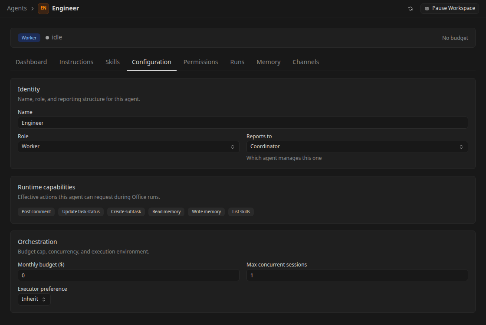

# Configure an Office agent team

Use this guide to give each Office agent a clear responsibility and the execution settings it needs before assigning work.

Start with an [Office workspace](office-getting-started.md) and a working execution profile. An Office identity persists across runs; its execution profile and executor determine how and where those runs execute.

## Add team members

Open **Agents** and use the create-agent action, or the add action beside the sidebar's agent section. Give each agent a unique name, choose a role, and optionally select **Reports to**.

For a small delivery team, create an **Engineer** with the Worker role and a **Reviewer** with the QA role, both reporting to the coordinator. Role choices include CEO, Worker, Specialist, Assistant, Security, QA, and DevOps; the configuration page previews the role's capabilities.

Set **Max concurrent** conservatively at first. This bounds the agent's simultaneous sessions, while workspace and runtime admission limits can impose additional bounds. Choose an executor preference and review the monthly budget field. A zero agent monthly budget means that field has no limit; workspace budget policies and the built-in ceiling still apply.

Open the new agent's **Configuration** page to review the saved identity, reporting relationship, orchestration settings, and routing choices.

CEO agents are top-level and cannot report to another agent. Other reporting relationships must stay in the workspace and cannot point to the agent itself or form a cycle. Select **Agent topology** beside **Agents** in the sidebar to open the **Org** view and inspect the resulting team structure.

## Choose how the agent executes

In **Configuration**, select the desired tier and provider ordering where available. The workspace route supplies execution profiles; agent overrides can narrow the provider choices. Follow [Provider routing](office-provider-routing.md) to configure the routes themselves.

When **Dynamic agent routing** is enabled, Configuration also exposes a dynamic execution-profile selector. This is a separately gated capability; see [Agents and profiles](agents-and-profiles.md) for dynamic profiles and health behavior.

The execution profile supplies provider settings, while the Office agent keeps its instructions, skills, permissions, and task history. A switch to another execution profile starts a fresh provider session when necessary; provider-native chat history is not transferred between providers.

## Write operating instructions

Open **Instructions**, select an instruction file, edit it, and save. The editor supports multiple files and an entry file; keep the starting instructions short enough to make the agent's responsibility and escalation rules clear.

A worker's instructions could say:

> Own small customer portal changes. Read the task's acceptance checks before editing. Run the relevant tests, explain the result, and request review. Ask the coordinator when scope or repository access is unclear. Do not merge or publish without the required human decision.

Put reusable procedure in a skill and task-specific acceptance criteria in the task's description or documents. This avoids copying a changing task plan into every agent's permanent instructions.

## Create and assign skills

Open workspace **Skills** to inspect the skill library. Create a workspace skill with a name, slug, and Markdown instructions, then save it. System skills are bundled by Kandev and read-only; workspace skills can be edited.

Open the agent's **Skills** page and select its desired skills. Review the desired and actual installation state before relying on a skill. Desired selection describes what should be provisioned; a saved checkbox alone is not evidence that the running environment has installed it. Skill availability also depends on the runtime's supported installation mechanism.

Use a small skill for a concrete procedure, such as checking accessibility or writing a release summary. Inspect the files and references shown with a skill when you need to understand what it provides.

## Review permissions

Open **Permissions** and review the values inherited from the agent's role. Controls marked **Role default** show the default for that role; save explicit changes with **Save Permissions**.

Office permissions govern coordination actions, such as creating subtasks, creating or modifying agents, changing task status, spawning runs, and working with skills or memory. Provider permission settings and executor access remain separate: Office permissions do not sandbox a local shell or remove filesystem access granted to the provider process.

Open **Preferences** in the Office sidebar to set workspace approval requirements for new agents, task completion, and skill changes. Those approvals appear in **Inbox** when an action requires a human decision. Review [Office operations](office-operations.md) before broadening an unattended team's permissions.

## Inspect memory and run history

Use **Memory** to inspect the agent's persistent entries and their scope. Keep enduring preferences or learned facts there; use task documents for deliverables and the task conversation for current decisions.

Open **Runs** to inspect why an agent was woken and how each attempt ended. A run detail can show its prompt, conversation, events, runtime context, and tasks touched. The agent's **Dashboard** summarizes its activity, tasks, and reported costs.

If an agent is paused, errored, or stopped, read its reason before selecting **Return agent to service**. Correct the cause first; returning it to service does not fix credentials, a workspace pause, or an exhausted budget. See [recovery](office-operations.md#troubleshoot-waiting-or-failed-work).

## Evaluate external channels carefully

The agent's **Channels** page can store a Telegram, Slack, Discord, or webhook channel with JSON configuration and an associated long-lived channel task. It is an experimental connection surface, not a guided provider installation or a guarantee that adding a record configures the external service.

If evaluating it, use **Add Channel**, select the platform, supply the connector configuration, and verify inbound delivery to the linked task. Verify any outbound reply path separately. Keep provider secrets out of shared task documents and screenshots, and follow the deployment's [network security](security.md) guidance before exposing an endpoint.

Next, [assign a task to the team](office-tasks.md) and verify one complete delivery before creating a recurring routine.
