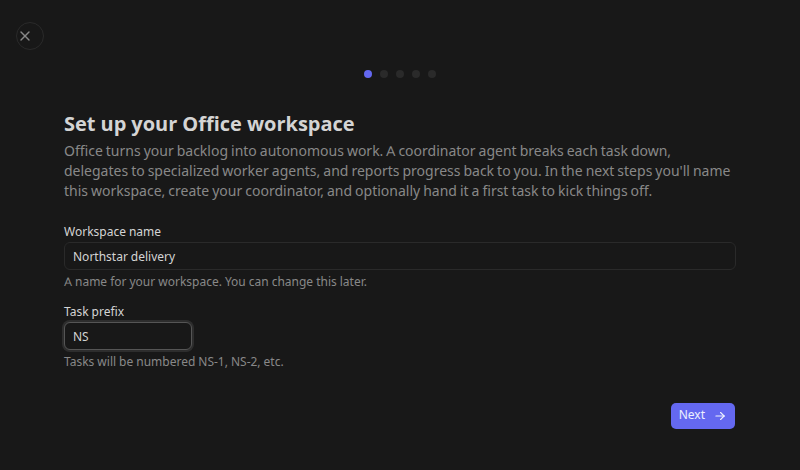

# Get started with Office

This tutorial creates an Office workspace with a coordinator and a first task whose result you can review.

## Before you begin

- Install and start Kandev using the [CLI](cli.md) or [desktop app](desktop-app.md).
- Have an installed, authenticated agent CLI and at least one enabled execution profile. See [Agents and profiles](agents-and-profiles.md).
- Choose an [executor](executors.md) with access to the files and tools your first task needs. Provider authentication must work in that execution environment.
- Choose a repository you are comfortable letting the team inspect, or start with a task that requires no repository.

Office remains experimental. Start with limited permissions and a small scope before leaving a team unattended.

## 1. Enable Office

Open **Settings > System > Feature Toggles**, enable **Office mode**, and save the change. Apply the restart requested by the settings page, then reload the app.

An operator can instead set `KANDEV_FEATURES_OFFICE=true` in the environment that starts Kandev. For example, with the CLI:

```bash
KANDEV_FEATURES_OFFICE=true kandev start
```

This affects the process started with that environment. For a service or container, set the variable in its startup configuration and restart that runtime. An explicit environment value takes precedence over a saved toggle, so an environment-locked setting must be changed there. See [Configuration](configuration.md).

## 2. Open the setup wizard

Open the workspace picker and choose **New office workspace**. The first Office visit also opens setup when onboarding has not been completed.

If Kandev discovers existing Office definitions on disk, setup offers an import path. Use it to restore existing definitions, or choose the fresh setup path to follow this tutorial. [Configuration management](office-operations.md#manage-workspace-configuration) explains the available import and sync choices.

Enter a workspace name and a task prefix. For example, use **Northstar** and **NS**. The prefix identifies the team's tasks; the workspace is the boundary for agents, projects, routines, and settings.



## 3. Choose the tier profiles

On **Setup tier agent profiles**, select an execution profile for each of **Frontier**, **Balanced**, and **Economy**. You can use the same working profile for all three initially; the wizard requires all three selections before continuing.

The tiers describe the execution choices available to the team. They are not additional Office agents. Select profiles already configured in Settings, or use the wizard's profile-creation controls for an available CLI.

For a provider fallback chain or later tier changes, use [Office provider routing](office-provider-routing.md).

## 4. Create the coordinator

Give the coordinator a name, select its agent profile, choose its executor preference, and select its default tier. **CEO** is the wizard's initial name; it is a role-bearing Office identity, not a requirement to use that title in your organization.

Use a local executor for a simple first evaluation when the required tools and files are available locally. Remote or container execution needs its own configured environment; choosing an executor type does not install dependencies or supply credentials.

## 5. Give it a bounded first task

The wizard pre-fills **Setup Workspace**. Its description asks the coordinator to inspect repositories, create projects and an agent team, propose next steps, and wait for human approval before follow-up work. Replace the example `https://github.com/org/repo` with your repository URLs and edit the scope before launching.

For a smaller first result, replace the brief with:

> Inspect the customer portal repository. Summarize how it builds and tests, identify the main components, and propose three small next steps. Do not change files or create follow-up tasks until I review the proposal.

A repository URL in the description is context for the agent. For repeatable code tasks, configure a project's repository sources as described in [Office tasks](office-tasks.md#create-a-project-and-connect-repositories).

Choose **Skip** to omit the starter task. This does not disable scheduled Office work: review the default coordinator routine after setup.

## 6. Review and launch

Review the workspace, coordinator, execution settings, and starter task, then select **Create & Launch**. With a starter task, onboarding creates the task and queues the coordinator's work. Without one, the workspace is created without that starter task.

The dashboard opens for the new workspace. Open **Tasks** and select the starter task. Read its conversation and proposal; task state and agent activity are separate, so inspect the actual output before treating work as delivered.

If the coordinator needs a decision, supply it in the task conversation or the relevant approval control. Keep approval instructions explicit, for example: “Proceed with the documentation task only; leave the other proposals for later.”

## 7. Configure the workspace before expanding it

Open **Preferences** in the Office sidebar (the workspace settings) and review approval requirements for new agents, task completion, and skill changes. Open **Costs > Budgets** to inspect the default ceiling and any policies, then check the coordinator's **Permissions** and **Instructions**.

Open **Routines** and inspect **Coordinator heartbeat**, the default lightweight coordinator routine installed during onboarding. It is initially active on a five-minute UTC schedule. Pause it if you want to finish configuration before scheduled coordinator wakes. See [coordinator scheduling](office-routines.md#review-the-default-coordinator-routine).

You now have a workspace and a first reviewable result. Continue with [agent teams](office-agents.md), [tasks and projects](office-tasks.md), and [routines](office-routines.md).

## If the first task does not start

- **Office is missing:** confirm the toggle is enabled in the running backend and that it has restarted. Check for an explicit environment override.
- **No profile is selectable:** configure an installed CLI and enabled profile in **Settings > Agents**, then return to setup.
- **A task exists but has no output:** inspect the agent's **Runs**, the workspace pause banner, and provider health. Check authentication and executor access before retrying.
- **A proposal waits for you:** answer its question or approval request. Waiting for a human is an expected outcome of the starter brief.

Use [Office operations](office-operations.md#troubleshoot-waiting-or-failed-work) for the recovery checklist.
