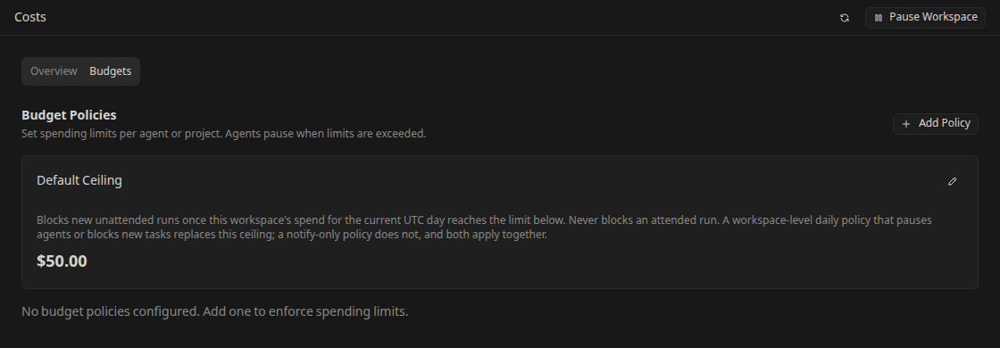
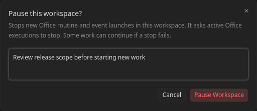

# Operate an Office workspace

Use this guide to monitor an Office team, bound unattended work, and resolve failures without losing track of its tasks and decisions.

For initial setup, follow [Get started with Office](office-getting-started.md). For routine configuration, use [Schedule Office routines](office-routines.md).

## Monitor progress and decisions

Use **Dashboard** for workspace metrics, agent activity, run trends, recent events, and spend. Open an agent's **Dashboard** for its own tasks and activity, and **Runs** for individual attempts and outcomes.

Use **Tasks** for delivery progress, **Inbox** for requests needing attention, and **Activity** for the event history. When diagnosing a problem, start at the affected task or run and use the workspace history to understand assignment changes, decisions, pauses, and budget actions.

Provider routing has its own health view. A degraded provider can make runs wait while the Office identity and task ownership stay unchanged. See [Provider routing](office-provider-routing.md) for fallback, blocked routes, and retry behavior.

## Control spend

Open **Costs** to inspect reported usage and breakdowns, then select **Budgets** to review the effective **Default Ceiling** and operator policies.

In the costs overview, **MTD** covers the current month from its start in UTC, while **Last 30 Days** covers a rolling 30-day window. The selected range applies to the total and the agent, project, model, and provider breakdowns.

The built-in ceiling defaults to **50 USD of priced spend per workspace per UTC day** for unattended runs. It blocks new unattended launches on reaching the limit; it does not block attended work. Check the effective value and edit the default ceiling in the Budgets tab when that bound is inappropriate for your evaluation.

To add a policy, select **Add Policy** and choose:

- **Scope Type:** workspace, agent, or project, with its **Scope ID**.
- **Limit ($):** the spending bound.
- **Period:** daily, monthly, yearly, or total.
- **Alert Threshold (%):** when to notify as usage approaches the bound.
- **Action on Exceed:** Notify only, Pause agent, or Block new tasks.

Select **Create Policy** and verify it appears in the list. The workspace ID is pre-filled for a workspace policy; agent or project policies need the corresponding entity ID.

**Notify only** is advisory. A blocking workspace-scoped daily policy can replace the built-in ceiling; a notify-only daily policy does not remove that ceiling. Agent and project policies do not replace the workspace default.

A policy card can show **Unknown** or **Unavailable** when observed spend is not available to that view. Treat that as missing information, not zero spending or a remaining allowance.

Admission evaluates spend before launch. This is not an exact provider billing cap: an already admitted run can add spend, and cost depends on available usage and pricing evidence. Unknown or unpriceable spend is not equivalent to free usage; inspect the budget outcome and usage warnings before increasing a limit or retrying. Agent monthly budget fields and policies are separate controls.

## Pause and resume a workspace

Use **Pause workspace** in the Office controls when you need to halt the team. Enter a reason and confirm. The persistent paused banner identifies the reason, actor, and time, and remains visible across Office pages and backend restarts.

Pausing blocks new Office launches and begins a halt sweep for queued or claimed runs and active Office executions in that workspace. Inspect the reported result because individual cancellation attempts can fail; a paused banner alone is not proof that every external process has already stopped. The pause does not stop a different workspace.

To allow work again, select **Resume workspace** and confirm. Resume lifts the launch barrier; it does not automatically replay work cancelled by the pause. Review tasks and run history, then explicitly restart the work you want. Use the pause-state refresh control if another operator changed the state while your page was open.

While pause state is loading, wait for the read to finish. If it cannot be read, use the refresh control and resolve the error; an absent paused banner alone does not establish that the workspace is running.

Pausing one routine only changes that routine. Returning one agent to service only changes that agent. Use the workspace pause when you need a barrier across manual, scheduled, and event-driven Office launch paths.

## Manage workspace configuration

Open **Preferences** in the Office sidebar for workspace appearance, approval requirements, recovery lookback, configuration controls, and the danger zone. This is separate from the app-wide **Settings** in the sidebar footer. The recovery lookback bounds how far back Office searches during recovery; it does not replace inspecting the affected task and run.

Choose one configuration ownership approach:

- **UI-managed:** edit the team and workspace through Office pages.
- **Filesystem definitions:** use **Sync** to inspect the filesystem/database diff and deliberately apply or export changes.
- **Repository-managed:** configure **Config Sync** to reconcile agents, skills, projects, and routines from a GitHub or GitLab repository.

For a portable backup of definitions, open **Export**, inspect the manifest and file previews, select the required files, and download the bundle. This exports definitions, not a complete backup of runtime state, conversation history, or secrets. Use [Operations](operations.md) for full data backup guidance.

[Office Config Sync](office-config-sync.md) owns repository layout, credentials, reconciliation, warnings, and deletion rules. Saving a sync source does not fetch it; use **Sync now** or wait for automatic polling. Repository-managed entities absent from a successful fetched configuration can be deleted, while hand-created entities remain unmanaged.

While a Config Sync source is configured, filesystem apply, bundle import, filesystem export, and raw-git Clone/Pull are unavailable to prevent competing configuration owners. Read-only diff and bundle export remain available. Raw-git Push writes the checkout using the backend's Git credentials; config sync itself never writes the repository.

Deleting an Office workspace requires confirming its name and removes its Office data. Export any definitions and back up data you need before using the danger-zone action.

## Troubleshoot waiting or failed work

Use this order to avoid retrying a task whose real problem is a missing decision or a launch barrier:

1. **Confirm the workspace.** Check the Office badge and selected name. Switching workspaces changes the view, not the background work of another team.
2. **Read the task's current gate.** Resolve blockers, unfinished child work, human questions, or reviewer/approver decisions. A waiting-decision indicator is not a provider failure.
3. **Check workspace pause and agent status.** Read the pause reason. Resume the workspace only when the team may run; correct an agent's cause before using **Return agent to service**.
4. **Inspect the latest run.** Read its reason, outcome, conversation, and event details. Distinguish a queued attempt from a claimed execution and a finished attempt from a completed task.
5. **Check provider health and execution setup.** Fix authentication, account limits, missing models, executor dependencies, or repository access. Retryable provider limits can recover automatically; credential or configuration failures need correction or a deliberate retry. Invalid agent or continue commands fail immediately rather than consuming automatic launch retries; correct the profile command before retrying.
6. **Inspect budgets and admission limits.** Read Activity and the run outcome for budget blocks or measurement failures. Concurrency and launch-rate limits can also delay work; do not create duplicate tasks to bypass them.
7. **Retry the intended work and verify output.** Confirm a new attempt and the expected task or routine result. Avoid repeated comments or Run now clicks while an earlier attempt is still queued or active.

If a session explicitly reports recovery is required, follow [session recovery](sessions-and-review.md) and keep the task's conversation and repository state available for the next attempt. Provider-native session continuity varies by runtime and execution profile.

For runtime logs, backups, and host-level investigation, use [Operations](operations.md). For scheduler and concurrency startup settings, use the Office entries in [Configuration](configuration.md).

## Use Office on a phone

Open the mobile navigation to select an Office workspace, then use its Tasks, Inbox, agents, and routines. Use task detail controls and confirmation dialogs for changes instead of relying on desktop drag interactions. The config Export page lets you select files, inspect one preview at a time, return to the list, and download.

Remote access needs the same authentication and network protections as the desktop UI. Follow [Mobile and remote access](mobile-remote-access.md) before exposing Kandev beyond the local machine.
