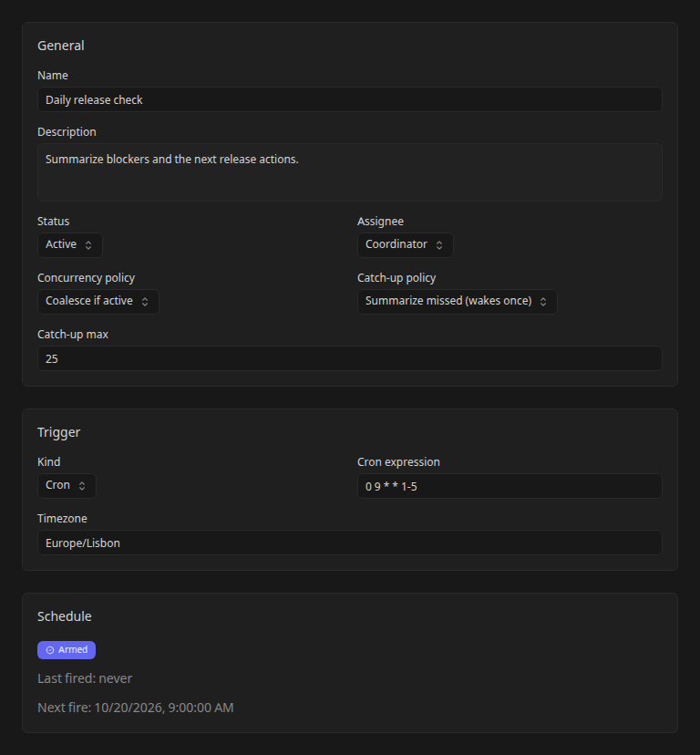

# Schedule Office routines

Use Office routines to wake a configured agent for repeatable work, such as a daily release check or a periodic project summary.

Start with an [Office team](office-agents.md) that has completed a bounded task successfully. Check permissions, provider routing, and [budgets](office-operations.md#control-spend) before enabling unattended work. Office routines are separate from regular Kanban [workspace automations](automation-and-mcp.md).

## Review the default coordinator routine

Onboarding installs **Coordinator heartbeat** for the coordinator. Its initial settings are Active, a five-minute UTC cron schedule (`*/5 * * * *`), Coalesce if active, Summarize missed, and a catch-up max of 25. It is lightweight: it has no task template and uses a run-owned session instead of creating a board task for every tick.

Open it in **Routines** to inspect, edit, or pause the schedule. If the coordinator has no scheduled wake, its agent page offers a hint linking to Routines. A routine can also exist without an armed trigger after an installation or scheduling failure, so verify its schedule state and Next fire time.

## Create a routine

Open **Routines** and choose **Create Routine**. The dialog has three steps:

1. **Details:** enter a name and description and choose the Office agent that will pick up the work.
2. **Task template:** enter the title and instructions for the recurring work. Make the expected output and escalation conditions explicit.
3. **Schedule:** choose the trigger, cron expression and timezone where applicable, concurrency policy, and catch-up policy. Create the routine, then open its detail page to inspect the saved schedule.

For a daily release check, use instructions such as:

> Read open customer portal tasks. Summarize blockers, pending approvals, and the next release actions. Request human decisions where needed. Do not create implementation tasks or publish a release.

Use a five-field cron expression such as `0 9 * * 1-5` for 09:00 Monday through Friday. Set a named timezone such as `Europe/Lisbon` for local scheduling or use `UTC` for a schedule independent of local daylight-saving changes. The **Next fire** display helps confirm the result.



The UI also offers a webhook trigger. Selecting it does not configure an external service to send requests; verify the endpoint and authentication for your deployment before relying on inbound delivery. Use cron for a first scheduled evaluation.

## Connect recurring work to its project and source results

When configuring a heavy routine through the routine API or config sync, its
JSON-encoded `task_template` can include `project_id` and `blocked_by`. The decoded
template looks like this:

```json
{
  "title": "Prepare the project report",
  "description": "Read the source task's result and prepare the next report.",
  "project_id": "<office-project-id>",
  "blocked_by": ["<source-task-id>"]
}
```

Use project and source-task IDs from the same workspace. The task is created with
the project's repository settings and normal dependency edges before it starts.
A source task is an explicit document-handoff dependency: unfinished sources
hold execution, while a completed source remains readable through that relation.
Project membership alone does not allow reading unrelated tasks.

These optional settings apply to newly created routine tasks. They do not move
or reopen earlier tasks, attach repositories retroactively, or change the
routine's concurrency policy. The optional `required_subtask_count` remains a
separate minimum for durable child assignments. No database migration is needed.

## Choose concurrency behavior

Concurrency determines what a fire does when matching routine work is already active:

| Policy | When to use it |
| --- | --- |
| **Skip if active** | The current check is enough; another fire can be dropped. |
| **Coalesce if active** | Reuse active work from the same routine instead of creating another task for every tick. |
| **Always create** | Each fire needs independent work; account for overlap and additional spend. |

With **Coalesce if active**, Kandev reuses a run only when that run belongs to the same routine. A different routine starts a separate run.

These policies govern routine work. Agent session limits, workspace admission limits, pause state, provider availability, and budgets can still delay or prevent execution.

## Choose downtime catch-up behavior

**Summarize missed** produces one catch-up run per due trigger after downtime, carrying a summary of missed ticks. It does not create one run for every missed tick. **Catch-up max** limits how many missed ticks are counted and reported, not how many catch-up runs execute.

**Skip missed** discards missed ticks and resumes the schedule without replaying that missed work.

For example, if Kandev is offline across several daily release checks, Summarize missed gives the agent one catch-up opportunity with the missed schedule context. Use Skip missed when an old check has no value after its scheduled time.

## Test the routine and read its output

Select **Run now** to test the saved routine, then inspect its run history. Confirm the chosen agent produced the intended summary or deliverable before relying on the schedule.

Routine fires can create linked task work; lightweight routine executions can also use a run-owned session without a task. Follow a linked task when one exists, or inspect the agent's **Runs** and the run conversation for taskless work. A run's completion and a task's delivery state remain separate.

If no run appears, check workspace pause state and the saved trigger. If a run exists but cannot start, inspect its outcome, provider health, and admission controls. A future Next fire time is a schedule prediction, not proof that an agent will be available then.

## Edit or pause a routine

Open the routine, edit its fields, and select **Save**. Check the resulting schedule status, last fire, and next fire rather than assuming a saved description also updated the trigger successfully. The UI reports schedule reconciliation errors separately; reload and resolve them before relying on the new timing.

Set the routine status to **Paused** when you want to suspend that routine. Use **Archived** when it should leave active use. To stop all Office work in a workspace, including event-driven wakes and manual routine launches, use the [workspace pause](office-operations.md#pause-and-resume-a-workspace).
