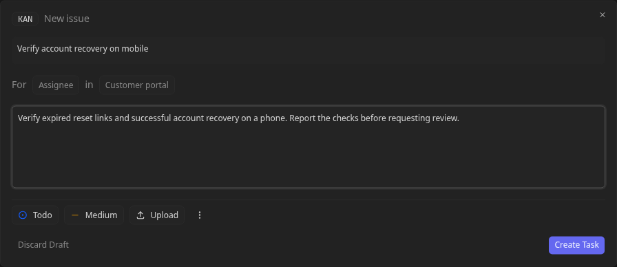
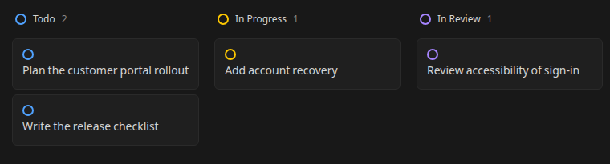
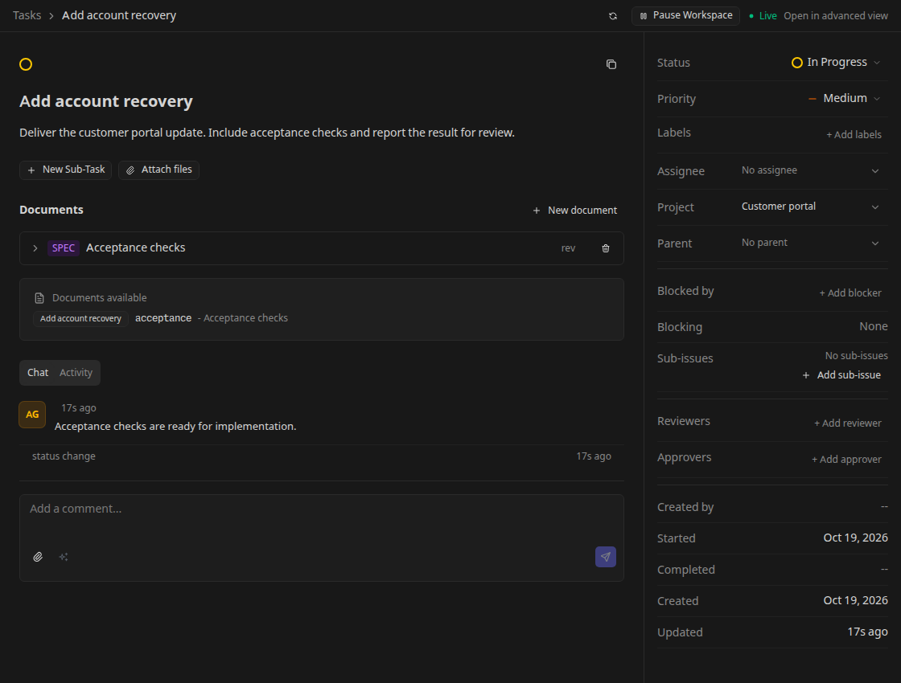

# Manage Office tasks

Use this guide to take work from a project brief through assignment, review, approval, and completion in an Office workspace.

You need an [Office workspace](office-getting-started.md) and configured [agents](office-agents.md). Begin with a task small enough that you can inspect its output and verify its acceptance criteria.

## Create a project and connect repositories

Open **Projects** or the sidebar's project add action, create a project, and open its detail page. Set its repository sources and executor settings before creating code tasks.

A project can list local repository paths and supported Git URLs. Root tasks created with that project and no explicit repository selection attach the project's sources before their first launch. An explicit repository selection takes precedence, and a child inherits its parent's repository context. Invalid or unreadable project sources can prevent task creation.

Changing the project's sources later does not change existing task attachments. Check the task's actual repository context if it was created before a project edit. See [Executors](executors.md) for environment setup and [Git operations](git-operations.md) for worktrees and repository behavior.

## Create and assign a task

1. Select **New Task**.
2. Enter a title and a description with the expected result and acceptance checks.
3. Choose a **Project**. The Office task dialog requires a project and a non-empty title before enabling Create.
4. Choose an **Assignee**, status, and priority. Choose an Office team member as the assignee; its runtime execution profile is configured separately.
5. Create the task and open its detail page to inspect the saved properties and activity.

For example, “Add account recovery” should explain expired-link behavior, successful reset behavior, and the tests you expect. “Improve the portal” leaves the result and stopping point unclear.

Assignments and workflow events can wake an agent. Do not assign runnable work while assuming the agent will wait for another manual launch. Use Backlog for planned work and the workspace pause when you need to prevent all Office launches while configuring a team.

An assignment wake requires a workflow step that permits automatic agent start and no known pending blocker. Changing the assignee does not override those conditions. When a prerequisite completes, Office can wake an eligible dependent even if that dependent has never had an agent session.

## Find and follow work

Open **Tasks** and switch between list and board views. Use search, filters, grouping, sorting, and nesting controls to find the relevant work. **Show system tasks** includes internal work such as channel tasks when you need to inspect it.

The Office board groups tasks by status, with columns such as Todo, In Progress, In Review, and Blocked. Those status columns are distinct from the default workflow's Work, Review, and Approval steps. A task's status, workflow position, and live execution indicator describe different things; a quiet agent does not prove delivery is complete. Open the task to inspect its conversation, documents, and current gate.

## Use the task detail and conversation

The task detail brings together properties, documents, subtasks, and activity. Edit the title or description when the brief changes and use the property controls for assignee, project, priority, labels, parent, and blocker relationships.

To remove a label, select its remove control in the **Labels** row. Names such
as `area/backend` work the same as simple names. Removal persists when you
reload the task and affects only this task's association; the workspace catalog
entry and labels on other tasks remain available.

Task-label removal API reference

Use `DELETE /api/v1/office/workspaces/:wsId/tasks/:taskId/labels?name=<encoded-name>`
with one query-encoded name. For example, `area/backend` becomes
`name=area%2Fbackend`; a literal `area%2Fbackend` becomes
`name=area%252Fbackend`. Encode a literal plus as `%2B` and a space as `+` or
`%20`. The name is decoded once and matched exactly, including stored spaces.

Success returns HTTP 200 with `{"ok":true}`, including when the valid name is
already absent from the task. Missing, empty, repeated, or malformed name
parameters return HTTP 400 without removing labels. Existing authorization
rules require access to the workspace and task, which must belong together.

The existing `DELETE .../labels/:labelName` route remains compatible with
single-segment names. Use the query endpoint for slash-containing names.
Removing a task association does not delete the workspace label.

Comments are durable task discussion and can wake the relevant agent. In Work they target the primary agent; in Review or Approval the default workflow targets participants who have not yet decided. State what you want the recipient to do, such as “Address the two accessibility findings and request another review.”

Use **Advanced** mode when you need the task's execution workbench and session conversation. **Simple** mode returns to the Office task view. See [Sessions and review](sessions-and-review.md) and [Developer tools](developer-tools.md) for chat, terminal, editor, changes, and diff behavior.

## Keep deliverables in documents

Use the task's documents to keep named plans, specifications, notes, and other Markdown deliverables alongside the work. Open a document to read or edit its content and inspect revision history when checking how a proposal changed.

Prefer a short task description with acceptance criteria and separate documents for a long plan or design. Task documents are an Office capability; their presence does not imply that regular Kanban has the same document panel.

## Break down work and record dependencies

Add subtasks when parts of a goal need separate ownership or review. Office supports deeper task trees, unlike regular Kanban's one-level subtask boundary. Use the parent picker to attach work to a parent or select **No parent** to detach it.

Use **Blocked by** for prerequisites that must finish before a task can proceed. **Blocking** shows the reverse relationship. Dependencies must remain in the same workspace and cannot reference the task itself or introduce a cycle.

Blocker checks treat Completed, Failed, and Cancelled tasks as terminal. Inspect a prerequisite's result before allowing follow-up work when the dependent requires successful delivery.

Parent structure groups work; a blocker expresses a prerequisite. Do not use a parent relationship as a substitute for a blocker when sequencing matters. Agents can receive a wake when blockers resolve or children complete, so tell the parent agent what to do with those results.

Children inheriting a parent's materialized workspace share files. Concurrent edits can conflict even when they have separate task conversations. Use separate execution environments when the work needs isolation, and review the [coordination guide](coordination.md) for shared-workspace trade-offs.

## Work through review and approval

The default workflow moves Work → Review → Approval → Done. Work requires an explicit completion signal for automatic advancement. Review and Approval wait for decisions from their participant roles.

1. Open the task and inspect its current workflow step and waiting-decision indicator.
2. Check the participant list for the required reviewer or approver. An automatic seat can exist before a concrete agent claims it; select or register the intended agent when necessary.
3. Read the output and guide the assigned reviewer or approver agent through the task conversation. Give concrete instructions, such as “Check the acceptance tests and record your review decision; request changes if the expired-link case is missing.” The agent records the workflow approval or request for changes.
4. Inspect the recorded decision and resulting transition. All required approvals allow advancement; a rejection returns the task to Work for revision.
5. After revision, review again. Entering a new review or approval round clears previous decisions so stale approvals cannot finish a changed task.

Workflow participants are Office agents; human users have no workflow approval or request-changes buttons. A human comment saying “looks good” provides guidance but does not satisfy the workflow gate. Confirm that the intended agent recorded a decision rather than treating its conversational reply as an approval.

The primary assignee, reviewer, and approver are distinct capacities. A team member can hold more than one capacity on a task; removing one does not necessarily end its session while it still holds another.

Task-completion approval is also a workspace setting. Marking a task Done can be rejected or redirected to review when the workflow is not at its terminal step or required approvals are pending. Resolve the named gate instead of repeatedly changing status.

## Handle human requests

Open **Inbox** to review pending approval requests and items needing attention. Inspect the linked task or agent before approving or rejecting an action. Workspace governance requests, such as hiring an agent or changing skills, have their own human approval controls. Workflow review requests link back to the task, where you guide the reviewer or approver agent as described above.

Answer a task question in the place it was asked. When granting partial approval, state the allowed scope explicitly. After a decision, revisit the task to confirm that the requested action or next workflow step occurred.

If a task remains waiting or a run fails, use the [operations checklist](office-operations.md#troubleshoot-waiting-or-failed-work).
