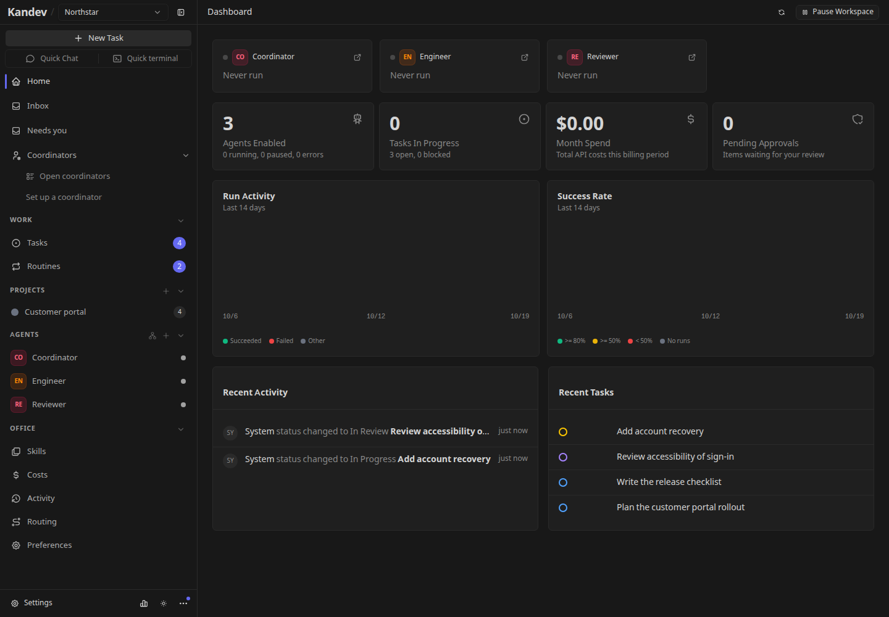

# Office mode

Office lets you organize persistent agent teams around projects, assign work, schedule routines, and review the results from one workspace.

**Office is experimental and disabled by default in production.** Enable it explicitly to evaluate it. Its UI, background automation, and configuration may change between releases; these guides describe the current implementation, not a stable production contract.

## Start here

- [Get started](office-getting-started.md): enable Office, configure execution profiles, create a workspace, and give its coordinator a first task.
- [Configure an agent team](office-agents.md): set responsibilities, reporting relationships, instructions, skills, permissions, and execution choices.
- [Manage Office tasks](office-tasks.md): connect projects to repositories, assign tasks, use subtasks and blockers, and work through reviews and approvals.
- [Schedule routines](office-routines.md): automate recurring work, choose concurrency and catch-up behavior, and inspect runs.
- [Operate an Office workspace](office-operations.md): monitor activity, control spend, pause work, recover agents, and manage configuration.
- [Provider routing](office-provider-routing.md) and [Config sync](office-config-sync.md): detailed configuration references.

## How Office fits together

An **Office workspace** holds the team, its projects, tasks, routines, and workspace settings. The workspace picker labels Office and Kanban workspaces separately. Selecting a workspace changes which team's work you see; it does not stop another workspace's agents.

An **Office agent** is a persistent identity with a name, role, instructions, skills, permissions, and history. An **execution profile** selects the provider CLI, model, and launch settings used to run that identity. An **executor** selects where the process runs. Changing a provider does not create a new Office team member.

A **project** groups work and supplies repository sources and execution defaults. A **task** holds a concrete goal, conversation, documents, assignee, and workflow position. Reviewers and approvers can participate in the same task without replacing its primary assignee.

A **run** is an individual attempt to wake an agent for a reason, such as an assignment, comment, or routine. A successful run does not by itself mean the task is complete: the workflow and its decisions still govern completion.

The dashboard is the team's overview. Open **Tasks** for delivery progress, an agent for its configuration and runs, **Inbox** for items needing attention, and **Activity** for the workspace's event history.

## The default delivery flow

The default Office workflow has five stages:

1. **Backlog:** work waiting to be started.
2. **Work:** the primary agent works on the task. The workflow requires an explicit completion signal before automatic advancement.
3. **Review:** reviewer participants inspect the result. All required approvals allow advancement; a rejection sends the task back to Work.
4. **Approval:** approver participants make the final decision. All required approvals allow advancement; a rejection returns it to Work.
5. **Done:** entry into the terminal step completes the task.

Review and Approval can create an automatic participant seat when one is needed. A task can therefore be waiting for a reviewer or approver to be selected, or for a recorded decision, even while no agent is running. See [reviews and approvals](office-tasks.md#work-through-review-and-approval).

## Start with a small team

Begin with one coordinator, one bounded task, and a project you can inspect. Review the coordinator's proposed plan before expanding the team or enabling recurring work. Office provides approval controls, permissions, budgets, and a workspace pause, but those controls do not replace reviewing instructions and executor access.

Office routines and teams are separate from regular Kanban [workspace automations](automation-and-mcp.md). Workflow YAML import/export covers regular Kanban workflows and excludes Office workflows. See [Feature status](feature-status.md) for the supported regular-Kanban boundary.

The workspace **Coordinators**, **Needs you**, and **Queue** surfaces have their own [coordinator autonomy settings](coordinator.md). Configure an Office CEO under **Agents**, and use Office routines, budgets, and workspace pause to control this team's work.
